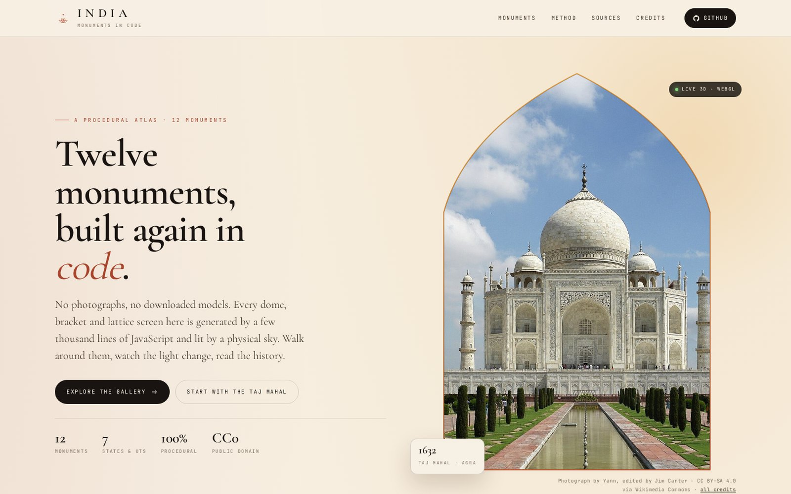

# INDIA — monuments in code

<!-- shot:start -->


<!-- shot:end -->

**Help build these models better.** Most of them are approximations and some are
rough: every monument carries a level — *measured*, *approximate* or *study* — and
the level says what it actually is. If you improve one, **your name and a link go
on the site and inside the model** — on the monument's page, on its row of the
[credits page](https://drsamonline.github.io/INDIA/credits.html#improve), and in
the header comment of its module file. No copyright assignment, nothing to sign.
[CONTRIBUTING.md](CONTRIBUTING.md) has the deal and the list of what is weakest.

**Twenty-four Indian monuments, rebuilt as live 3D miniatures in the browser.** No photographs in the models, no downloaded meshes, no build step: every dome, bracket and lattice screen is generated from code with [three.js](https://threejs.org), lit by a physical sky, and paired with the history behind it.

[](LICENSE)
[](https://threejs.org)
[](#the-monuments)
[](#run-it-locally)
[](#browser-support)

**Landing page → [drsamonline.github.io/INDIA](https://drsamonline.github.io/INDIA/)**



---

## The monuments

| # | Monument | Place | Period | Page |
|---|---|---|---|---|
| 1 | Taj Mahal | Agra, Uttar Pradesh | Mughal · 1632–1653 | [open](monuments/taj-mahal.html) |
| 2 | Qutb Minar | Mehrauli, Delhi, Delhi | Delhi Sultanate · 1199–1220 | [open](monuments/qutub-minar.html) |
| 3 | Hawa Mahal | Jaipur, Rajasthan | Rajput · 1799 | [open](monuments/hawa-mahal.html) |
| 4 | Charminar | Hyderabad, Telangana | Qutb Shahi · 1591 | [open](monuments/charminar.html) |
| 5 | Gateway of India | Mumbai, Maharashtra | British Raj · 1913–1924 | [open](monuments/gateway-of-india.html) |
| 6 | India Gate | New Delhi, Delhi | British Raj · 1921–1931 | [open](monuments/india-gate.html) |
| 7 | Mysore Palace | Mysuru, Karnataka | Wadiyar dynasty · 1897–1912 | [open](monuments/mysore-palace.html) |
| 8 | Golden Temple | Amritsar, Punjab | Sikh · founded 1577, gilded 1830 | [open](monuments/golden-temple.html) |
| 9 | Konark Sun Temple | Konark, Odisha | Eastern Ganga · c. 1250 | [open](monuments/konark-sun-temple.html) |
| 10 | Sanchi Stupa | Sanchi, Madhya Pradesh | Mauryan · 3rd century BCE | [open](monuments/sanchi-stupa.html) |
| 11 | Victoria Memorial | Kolkata, West Bengal | British Raj · 1906–1921 | [open](monuments/victoria-memorial.html) |
| 12 | Meenakshi Temple | Madurai, Tamil Nadu | Pandya and Vijayanagara · 12th–17th c. | [open](monuments/meenakshi-temple.html) |
| 13 | Lotus Temple | New Delhi, Delhi | Bahá’í · 1980–1986 | [open](monuments/lotus-temple.html) |
| 14 | Shore Temple | Mahabalipuram, Tamil Nadu | Pallava · c. 725 CE | [open](monuments/shore-temple.html) |
| 15 | Rani ki Vav | Patan, Gujarat | Solanki · 1063 | [open](monuments/rani-ki-vav.html) |
| 16 | Amber Fort | Amer, Jaipur, Rajasthan | Kachwaha Rajput · from 1592 | [open](monuments/amber-fort.html) |
| 17 | CSMT, Mumbai | Mumbai, Maharashtra | British Raj · 1878–1888 | [open](monuments/csmt-mumbai.html) |
| 18 | Mahabodhi Temple | Bodh Gaya, Bihar | Mauryan to Gupta · 3rd c. BCE – 6th c. CE | [open](monuments/mahabodhi-temple.html) |
| 19 | Statue of Unity | Kevadia, Gujarat | Modern · 2013–2018 | [open](monuments/statue-of-unity.html) |
| 20 | Kandariya Mahadeva | Khajuraho, Madhya Pradesh | Chandela · c. 1030 | [open](monuments/kandariya-mahadeva.html) |
| 21 | Basilica of Bom Jesus | Old Goa, Goa | Portuguese · 1594–1605 | [open](monuments/basilica-bom-jesus.html) |
| 22 | Mehrangarh | Jodhpur, Rajasthan | Rathore Rajput · from 1459 | [open](monuments/mehrangarh-fort.html) |
| 23 | Jantar Mantar | Jaipur, Rajasthan | Rajput · 1728–1734 | [open](monuments/jantar-mantar.html) |
| 24 | Somnath Temple | Prabhas Patan, Gujarat | Rebuilt · 1951 | [open](monuments/somnath-temple.html) |

Thirteen of them are UNESCO World Heritage Sites; two more are on the tentative list.

## What is on each page

- **A procedural model** — 25,000–690,000 triangles merged into a few dozen draw calls, with MSAA, soft shadows, bloom, a filmic grade and a miniature tilt-shift lens.
- **A sky that moves** — a physical Rayleigh/Mie sky, sun and moon, stars, clouds, mist and monsoon rain, over a neutral studio environment map that gives marble, gold and stone a believable specular response. Drag the time slider from dawn to night.
- **Viewpoints** — four to six camera positions per monument, each with its own tour stop.
- **A guided tour** — a narrated walk through the building's history, its parts and its setting.
- **The history** — a drawer with the story, quick facts, links to Wikipedia, UNESCO and the ASI, and the credit for the photograph on the landing page.
- **Controls** — exposure, bloom, blur, wireframe, grid, quality, screenshot, auto-orbit, day–night cycle.

Keyboard: `H` panel · `T` tour · `A` about · `C` cinema mode · `R` reset · `1`–`9` viewpoints · `Esc` close.

## Run it locally

The pages are ES modules, so they need to be served over HTTP (opening `index.html` from the file system will not work in most browsers):

```bash
git clone https://github.com/drsamonline/INDIA.git
cd INDIA
python3 -m http.server 8080
# open http://localhost:8080
```

No `npm install`, no bundler, no framework. three.js is vendored in `assets/vendor/three`.

## How it is built

```
index.html                  landing page (generated)
credits.html                sources, licences, photographers (generated)
monuments/<id>.html         one page per monument (generated, thin shell)
data/monuments.json         the single source of truth for text, facts, images
assets/js/monument-engine.js  shared engine: sky, light, weather, UI, tour, history
assets/js/monuments/<id>.js   one geometry module per monument
assets/css/monument.css     interface for the monument pages
assets/css/site.css         landing page
tools/build_site.py         generates the pages from data/monuments.json
tools/build_taj.py          adapts the original Taj Mahal scene into the site
tools/qa.py                 headless-Chromium render check
tools/linkcheck.py          every internal reference resolves
tools/audit_data.py         data + copy audit (structure, years, images, AI tells)
tools/check_a11y.py         skip link, canvas semantics, drawer focus trap
tools/check_ui.py           the documented keyboard shortcuts, exercised
tools/framecheck.py         named views and tour stops frame their subject
tools/tintcheck.py          flags material tints taken from textured bases (--ci: new ones only)
tools/build_gallery.py      rebuilds docs/gallery.jpg from shots/audit
tools/build_extras.py       robots.txt, sitemap.xml, 404.html
tools/MONUMENT-CONTRACT.md  how to write a new monument module
tools/check_a11y_all.py     the a11y gate over every page, resumably, per viewport
tools/contact_sheet.py      four pages to one image, for checking a global change
tools/measure.py            measures the built geometry in metres, to check DIMENSIONS
CONTRIBUTING.md             how to improve a model, and how the credit works
HANDOFF.md                  the brief: state of play, traps, working method
docs/WORKLOG.md             the history: one numbered section per piece of work
ROADMAP.md, DIMENSIONS.md   what is left, and measured-vs-model for each monument
```

A monument module exports an object with its camera, colours and a `build(ctx)` function. `ctx` supplies primitives (box, cylinder, lathe, dome, arch), composite helpers (arcade, chhatri, railing, tree, person), a palette of forty materials — marble, sandstone, basalt, gold, jali screens — and the scene's floodlights. Everything a module adds is merged by material when it returns.

```js
export default {
  id: 'qutub-minar',
  home: { pos: [76, 30, 98], target: [0, 32, 0] },
  ground: { texture: 'paving', size: 1600 },
  views: [{ name: 'Full', pos: [76, 30, 98], target: [0, 32, 0] }],
  tour: [{ title: 'The Victory Tower', text: '…', pos: [76, 30, 98], target: [0, 32, 0], time: 17.4 }],
  build(ctx) {
    const { add, cyl, dome, archFrame } = ctx;
    add('sandstoneRed', ctx.lathe([[7.2, 0], [6.1, 24.4]], 48), 0, 2, 0);
    // …
  }
};
```

Adding a twenty-fifth monument: write `assets/js/monuments/<id>.js`, add its entry to `data/monuments.json`, run `python3 tools/build_site.py`. The contract is in [`tools/MONUMENT-CONTRACT.md`](tools/MONUMENT-CONTRACT.md).

## Checks

```bash
python3 tools/build_site.py     # regenerate the pages
python3 tools/linkcheck.py      # every internal href/src/srcset resolves
python3 tools/audit_data.py     # structure, years, image files, copy tells
python3 tools/audit_data.py --links   # also HEAD every external link
python3 tools/check_all.py      # render every page in headless Chromium
python3 tools/check_a11y.py     # skip link, canvas semantics, drawer focus trap
python3 tools/check_ui.py       # H T A C R and 1-9 actually do something
python3 tools/framecheck.py     # every view and tour stop frames its subject
python3 tools/tintcheck.py --ci # no NEW material tinted off a textured base
```

CI runs the first three on every push and fails if the generated pages are
stale.

## Browser support

Needs WebGL 2 and ES modules: current Chrome, Edge, Firefox and Safari, on desktop and mobile. The interface adapts to phones (the control panel becomes a bottom sheet, the tour card sits above it). `prefers-reduced-motion` is respected. Without JavaScript the page still links to the monument's Wikipedia article.

## Licence

- **Code and 3D models** — [CC BY-NC 4.0](LICENSE). Copy, remix and publish with credit to **Dr Sohil Momin** and a link to the licence; not for commercial use.
- **Text** — adapted from Wikipedia under [CC BY-SA 4.0](https://creativecommons.org/licenses/by-sa/4.0/); the adapted text is offered under the same licence.
- **Photographs** — each under its own licence (CC BY, CC BY-SA, FAL, GFDL), credited per file in [credits.html](credits.html).
- **three.js** — MIT. **Typefaces** (Cormorant Garamond, JetBrains Mono, Noto Sans Devanagari) — SIL Open Font License 1.1.

## Author

**Dr Sohil Momin** — [github.com/drsamonline](https://github.com/drsamonline)

If you build something with these models, a link back to the [landing page](https://drsamonline.github.io/INDIA/) is always welcome.
